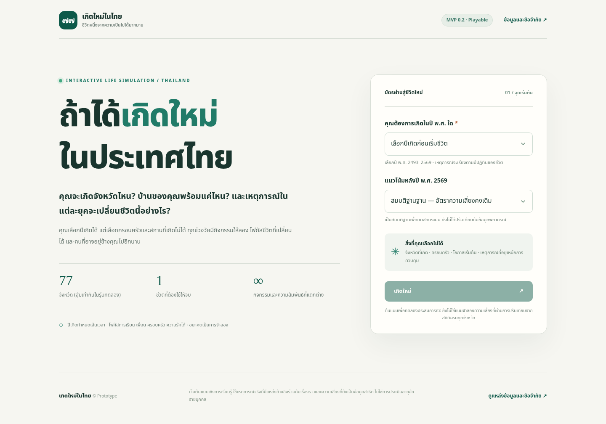

# Koet Mai Thai | Interactive Life Simulation

**Version:** 0.2.1 (prototype)  
**Language:** Thai  
**Deployment:** GitHub Pages (static hosting, no backend or API keys)

An interactive, Thai-language life-simulation website inspired by the question: *How different could a life become if you could choose a birth year, but not your birthplace or family?*



> **Prototype notice:** All personal outcomes and mortality risks are simulated with experimental assumptions. This is not an actuarially calibrated model, a personal medical prediction, or an AI forecast. Birthplace selection currently uses **equal weights for 77 provinces**. The historical event dataset is a small verified sample, not an exhaustive timeline.

## Features

- Select a **Buddhist Era (BE) birth year, 2493-2569**, before starting.
- Randomly generate a birthplace from **77 Thai provinces**, a household, initial circumstances, and a reproducible random seed.
- Keep **calendar years aligned**: character's year = birth year + age.
- Show dated historical events during their actual years; separate these from fictional, character-specific outcomes.
- Continue past 2569 and simulate the character's future until death (technical ceiling: age 120).
- Play one year at a time, jump 10 years with automatic decision selection, or run a full life automatically.
- Encounter **interactive activities every year, ages 6-18**, plus age-dependent activities and milestone decisions afterward.
- Choose a focus: school, sports, family, friendship, hobbies, romance, work, finance, health, etc.
- Build relationships with named friends, carers/family members, and romantic partners; spend time with someone once a year.
- Automatically save and resume the current run on the **same browser and site origin** using localStorage.
- Keep a local, limited record of past simulated lives and copy an end-of-life summary.
- Responsive design suitable for desktop and mobile screens.

## Repository layout

```text
koet-mai-thai/
|-- .github/
|   `-- workflows/
|       `-- pages.yml          # CI: test and auto-publish to GitHub Pages
|-- .gitignore
|-- .nojekyll
|-- .editorconfig
|-- index.html                # Entry page (HTML, no server framework)
|-- favicon.svg
|-- assets/
|   |-- style.css             # Responsive UI
|   |-- data.js               # Provinces, historic province labels, historical events
|   |-- events.js             # Activities, milestone decisions, relationship rules
|   `-- sim.js                # Seeded simulation, UI, state, and local saves
|-- docs/
|   |-- ENGINE_NOTES.md       # Mechanics, assumptions, sources, known limits
|   `-- screenshots/
|       |-- landing.png
|       `-- mobile.png
|-- scripts/
|   `-- build.mjs             # Creates dist/ without dependencies
|-- package.json
|-- test_mvp.js               # Automated smoke/regression tests
`-- README.md
```

The generated `dist/` folder is excluded from source control. GitHub Actions generates and deploys it automatically. **Do not upload only the ZIP file to your repository:** extract it and upload the files *inside* it, including `.github/workflows/pages.yml`.

## Publish using the GitHub website (no terminal)

1. Sign in to [GitHub](https://github.com/) and create a **new, empty repository** such as `koet-mai-thai`. Set its visibility to **Public** if using GitHub Free. Do not initialize it with a README, `.gitignore`, or license; this package already contains what it needs.
2. **Download and extract** the ZIP delivered with this project.
3. Inside GitHub's repository, select **Add file > Upload files**. Drag **the contents of the extracted folder**, not the outer folder or ZIP. Make sure the hidden `.github/workflows/pages.yml` is also committed. You can upload it separately using **Add file > Create new file** with that exact path if the file uploader misses the hidden folder.
4. Commit the files directly to the `main` branch.
5. Open **Settings > Pages**. Under **Build and deployment**, set **Source = GitHub Actions**.
6. Open the **Actions** tab. The workflow **Test and deploy GitHub Pages** should run on each push to `main`. Wait for both `verify` and `deploy` to show success.
7. Open the web URL shown in **Settings > Pages > Visit site**. Usually this is `https://YOUR_USERNAME.github.io/REPOSITORY_NAME/`.

If no workflow runs, verify that the branch is called `main`, the workflow file was uploaded under `.github/workflows/pages.yml`, and GitHub Actions is enabled for the repository.

## Publish using Git (alternative)

Create an empty GitHub repository first. Then, in the **extracted project directory**:

```bash
git init
git branch -M main
git add -A
git commit -m "Initial Koet Mai Thai release"
git remote add origin https://github.com/YOUR_USERNAME/YOUR_REPOSITORY.git
git push -u origin main
```

Then select **Settings > Pages > Source: GitHub Actions**. If you update the site later, commit and push to `main` again: tests run and the site redeploys automatically.

## Run locally

Open `index.html` in a modern browser. For a local HTTP server, use:

```bash
python3 -m http.server 8080
```

Then open `http://localhost:8080/`.

Node.js 20+ is useful for the provided tests but is **not required to run the website**. There are no npm dependencies to install.

```bash
npm test
npm run build
```

`npm test` checks JavaScript syntax and automated simulation scenarios. `npm run build` validates relative file references and copies public assets to `dist/`.

## What is real and what is simulated?

| Category | Current implementation |
| --- | --- |
| Birth years / BE calendar chronology | Actual year arithmetic |
| Historical national/provincial events | A small set of externally cited dated events |
| Province names over time | Historical parent-province labeling for newer provinces |
| Which province a character is born in | Simulated, **equal probability across 77 provinces** |
| Income, health, choices, friendships, relationships | Simulated / experimental assumptions |
| Mortality and future events | Simulated / experimental assumptions; **not predictions** |
| Real-time LLM or AI usage | **None**; no AI API keys are needed or embedded |

See [the model and data notes](docs/ENGINE_NOTES.md) for current details and source links.

## Privacy and saving

The project makes no first-party requests for player data. Progress is stored only in the browser's localStorage on that origin. Browser clearing, incognito mode, changing devices, or switching from `file://` to a GitHub Pages URL may prevent a saved game from carrying over. There is no cloud synchronization or user account.

**Never put an AI API key in `assets/*.js` or another public file.** Any future paid AI integrations will need a backend or authenticated serverless function to keep keys private and enforce budgets.

## Updating the project

- Change the page's content in `index.html`.
- Adjust styling in `assets/style.css`.
- Update historical events and province metadata in `assets/data.js`.
- Add activities and focus / relationship content in `assets/events.js`.
- Modify simulation rules in `assets/sim.js`, ideally adding tests for each change.
- Run `npm test` and `npm run build` before committing. GitHub Actions repeats both steps before deploying.

## Technical boundaries / next phases

This repository is a playable **MVP**, not a production-statistics release. The next scientific step is to replace equal province weights and example probabilities with year-relevant Thai vital statistics, income distributions, and cohort survival tables, with a source and year on each dataset. Then AI may be used to narrate **already simulated** events rather than determine their probabilities.

This is an independent project. It does not include third-party proprietary code or artwork from 1in8b.life. No open-source license has been selected in this package; choose one deliberately if you want to grant public code-reuse permissions.
